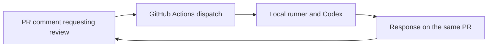

# Local documentation review through GitHub

Status: the private repository is published and its Mac runner is online. A
bootstrap review ran locally. The workflow awaits merge; the full PR-triggered
path remains unverified.

GitHub holds the PR and its discussion. A self-hosted GitHub Actions runner on
the user's Mac runs Codex with ChatGPT subscription authentication, then returns
the review to the PR. The agent process is local; model inference uses OpenAI.
The [review skill](SKILL.md) defines what to check and how to report findings.

## Using the loop

The [loop policy convention](../README.md) applies. This loop's policy is:

| Event or limit | Behavior |
|---|---|
| New PR | Review automatically when opened by a human collaborator with write access |
| Reopened or ready for review | Review if this revision has not already received an automatic response |
| Comment beginning `/review-docs` | Review or answer the supplied follow-up question |
| Push or commit | No automatic run; request another review when useful |
| Public repository, bot, or user without write access | Do not run |
| Input and runtime | At most 100 changed files, 100 Markdown documents per revision, 240 KB of context, and ten minutes for Codex |
| Limit exceeded or execution failure | Report an incomplete result; use the Actions job as fallback if authorization or posting is unavailable |

Comment `/review-docs` on an open PR to request another review or continue the
discussion, such as `/review-docs explain the second finding`. Each request
reads the current proposal and prior discussion and produces one response.
Publishing changed files requires a commit and push; discussion does not.
Discussion does not require a new commit.

The first loop reviews and proposes corrections. It does not edit files or
merge. Only repository collaborators with write access may invoke it. Keep the
repository private and the runner dedicated to this project.

## Execution and availability

The GitHub workflow lives in `.github/workflows/`; its review implementation
lives beside this file. Credentials stay on the local runner, outside the Git
repository. Subscription authentication and model use are distinct from GitHub
repository access. A future Claude adapter could use the same PR interface;
the first adapter uses Codex.

The runner must be online to accept work. Jobs wait when the Mac is asleep or
offline. Review scope and failures must be visible, rather than reported as a
successful clean review.

## Setup

1. Register a repository-level macOS self-hosted runner with the custom label
   `obsidian-recall`. Run it under the local account that holds Codex sign-in.
2. Make `codex` available to its service, or set `REVIEW_CODEX_BIN` in the runner
   environment. `REVIEW_CODEX_HOME` optionally selects a persistent auth home;
   otherwise the local account's `.codex` directory is used. Sign in with ChatGPT.
   The implementation requires the CLI's `--ignore-user-config` and
   `--ignore-rules` options; verify these when upgrading Codex.
3. Merge the approved workflow into the default branch. The comment and PR
   triggers execute that branch, so the setup PR alone does not activate them.
4. Open a PR and verify one response plus a completed Actions job. Reply with
   `/review-docs` and a question to continue the discussion. PRs already open
   before activation need an explicit request or reopening.

The workflow resolves an immutable default-branch SHA for the reviewer, even
when the PR targets another branch. It never executes the PR's proposed code.
Codex receives bounded Markdown snapshots, available diffs, and discussion as
input. It runs in a temporary directory with a read-only sandbox, tool access
disabled, and no inherited GitHub or API billing credentials. One registered
runner serializes jobs. A rerun of the same comment does not duplicate its reply.
Large or incomplete inputs produce an explicit incomplete result.
Failures before authorization, checkout, or a successful PR response remain
visible in Actions. A cancelled job or runner outage cannot guarantee a comment.

Official setup references:

- [OpenAI subscription authentication on self-hosted runners](https://learn.chatgpt.com/docs/auth/ci-cd-auth)
- [GitHub self-hosted runners](https://docs.github.com/en/actions/concepts/runners/self-hosted-runners)
- [Runner availability and queued jobs](https://docs.github.com/en/actions/reference/runners/self-hosted-runners)
