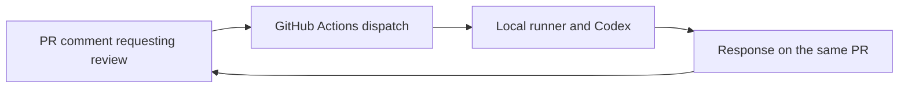

# Local documentation review through GitHub

Status: automatic PR reviews and comment follow-ups have successfully published
through GitHub's Actions bot account. See the [automatic review on PR #4](https://github.com/Lestode/obsidian-recall/pull/4#issuecomment-6337271832)
and the [follow-up on PR #2](https://github.com/Lestode/obsidian-recall/pull/2#issuecomment-6337493469).

GitHub holds the PR and its discussion. A self-hosted GitHub Actions runner on
the user's Mac runs Codex with ChatGPT subscription authentication, then returns
the review to the PR. The agent process is local; model inference uses OpenAI.
The [review skill](SKILL.md) defines what to check and how to report findings.

Every response begins with an explicit automated-agent label, the reviewer's
name, purpose, and engine. Its [identity metadata](identity.json) supplies this
header independently of the model's answer. Activated workflow responses use
GitHub's Actions bot account. A bootstrap report posted through a personal
account must disclose that publication method and identify the content as
agent-generated.

The approved reviewer configuration is GPT-6.1 Sol with **high** reasoning
effort, pinned in the identity metadata and passed explicitly to Codex. Reports
show these settings alongside the agent's purpose.

## Using the loop

The [loop policy convention](../README.md) applies. This loop's policy is:

| Event or limit | Behavior |
|---|---|
| New PR | Review automatically when opened by a human collaborator with write access |
| Reopened or ready for review | Review if this revision has not already received an automatic response |
| Comment beginning `/review-docs` on an open PR | Review or answer the supplied follow-up question |
| Command on a closed or merged PR | Post a short explanation and direct further discussion to an open PR; do not run Codex |
| Push or commit | No automatic run; request another review when useful |
| Public repository, bot, or user without write access | Do not run |
| Input and runtime | At most 100 changed files, 100 Markdown documents per revision, 512 KB (512,000 bytes) for the complete prompt, and ten minutes for Codex |
| Limit exceeded or execution failure | Report an incomplete result; use the Actions job as fallback if authorization or posting is unavailable |

Post a new comment beginning `/review-docs` in an open PR's **Conversation** tab
to request another review or continue the discussion, such as
`/review-docs explain the second finding`. Each request
reads the current proposal and prior discussion and produces one response.
Publishing changed files requires a commit and push; discussion does not.
Discussion does not require a new commit. Replies in inline review threads and
edits to existing comments do not trigger the reviewer.

Every published response ends with a short reminder of the command, where to
post it, and that agreed changes must be applied separately. The publishing
code adds this reminder, including for incomplete reviews. A command on a
closed or merged PR receives a notice instead of a review, with instructions
to continue on an open PR. Rerunning the same request does not duplicate the
notice. Follow-up changes after a merge need a new PR; agreement in discussion
does not update the merged files.

The first loop reviews and proposes corrections. It does not edit files or
merge. Only repository collaborators with write access may invoke it. Keep the
repository private and the runner dedicated to this project.

## Execution and availability

The GitHub workflow lives in `.github/workflows/`; its review implementation
lives beside this file. Credentials stay on the local runner, outside the Git
repository. Subscription authentication and model use are distinct from GitHub
repository access. A future Claude adapter could use the same PR interface;
the first adapter uses Codex.

The workflow's GitHub token has content-read and PR-write access so the harness
can publish PR comments. It is not passed to Codex. Issue-write access is not
needed. The workflow does not grant content-write access or authorize merging.

The runner must be online to accept work. Jobs wait when the Mac is asleep or
offline. Review scope and failures must be visible, rather than reported as a
successful clean review.

## Setup

1. Register a repository-level macOS self-hosted runner with the custom label
   `obsidian-recall`. Run it under the local account that holds Codex sign-in.
2. Make `codex` available to its service, or set `REVIEW_CODEX_BIN` in the runner
   environment. `REVIEW_CODEX_HOME` optionally selects a persistent auth home;
   otherwise the local account's `.codex` directory is used. Sign in with ChatGPT.
   The implementation requires the CLI's `--ignore-user-config` and
   `--ignore-rules` options; verify these when upgrading Codex.
3. Merge the approved workflow into the default branch. The comment and PR
   triggers execute that branch, so the setup PR alone does not activate them.
4. Open a PR and verify one response plus a completed Actions job. Reply with
   `/review-docs` and a question to continue the discussion. PRs already open
   before activation need an explicit request or reopening.

The workflow resolves an immutable default-branch SHA for the reviewer, even
when the PR targets another branch. It never executes the PR's proposed code.
Each request supplies one complete snapshot of the latest proposed Markdown,
plus the PR diff and discussion. Unchanged documents are not repeated as a
second repository snapshot. Earlier governing wording comes from complete
Markdown diff hunks; removed documents remain available in deletion patches.
New Markdown documents and content-preserving renames reference their supplied
text rather than repeating it as an additional patch. Renaming a Markdown file
to another extension retains that text for the comparison. Missing or truncated
Markdown changes stop the review; unavailable implementation patches are
explicitly marked as a coverage limit. Only Markdown changed on the target
branch since the PR branched is supplied as accepted-version overrides, so newly agreed rules are retained without a
second complete snapshot. Identical text references its supplied copy. The
collector checks that the PR did not move while it retrieved the input.

The 512 KB (512,000 bytes) limit includes instructions, the review procedure,
and serialized source material. Actions logs show the input size without
printing its content; limit errors report both the actual size and the cap.
This is a local input budget, not a model-reported context-window limit.

The wrapper starts a fresh ephemeral review for each request and removes its
temporary directory afterward. It does not accumulate earlier repository
snapshots between PR comments. Earlier decisions and findings remain in the PR
discussion. This describes the wrapper's input and local storage, not provider
prompt-cache or retention policy.

Codex receives this bounded input. It runs in a temporary directory with a
read-only sandbox, tool access disabled, and no inherited GitHub or API billing credentials. One registered
runner serializes jobs. A rerun of the same comment does not duplicate its reply.
Large or incomplete inputs produce an explicit incomplete result.
The formatted report is saved to the Actions job summary before publication,
so a posting failure does not discard the review. Publication errors expose
only a numeric HTTP status or a recognized local error category; request
headers, tokens, raw API responses, and subprocess output are not logged.
Failures before authorization, checkout, or a successful PR response remain
visible in Actions. A cancelled job or runner outage cannot guarantee a comment.

Official setup references:

- [OpenAI subscription authentication on self-hosted runners](https://learn.chatgpt.com/docs/auth/ci-cd-auth)
- [GitHub self-hosted runners](https://docs.github.com/en/actions/concepts/runners/self-hosted-runners)
- [Runner availability and queued jobs](https://docs.github.com/en/actions/reference/runners/self-hosted-runners)
