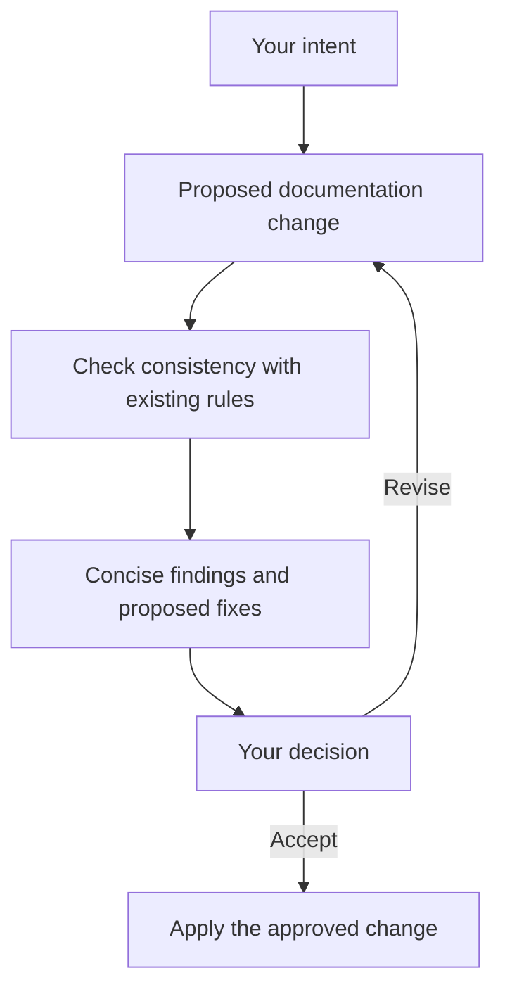

# Development from high level intent

Status: agreed working strategy. Automated review and GitHub integration are
not yet configured.

## Purpose

Spend human attention on intent and consequential decisions. Agents translate
high-level goals into concrete proposals and check that lower-level choices
preserve those goals and the project's existing constraints.

## The loop

## Agent responsibility

Read the relevant specification, inspect the proposed change for contradictions,
missing requirements, and ambiguity, and explain consequential findings with
supporting passages and proposed resolutions. Report missing context or
incomplete checks rather than presenting them as a clean result. Recheck
revisions against the original intent.

## Human responsibility

Define goals and priorities, resolve conflicting intentions, and approve
changes. Agents must not silently weaken a high-level rule to accommodate an
implementation. Once a scope is approved, agents can complete it without
repeated confirmation.

## Communication

Present the decision first. Group related findings and keep detailed evidence
available separately. Avoid repeated notifications for unchanged issues.
Distinguish proposals, agreed decisions, and implemented behavior.

## Putting it into practice

Use a feature branch and pull request for a coherent proposed change; push
revisions to that branch and merge after acceptance. Begin with one consistency
and redundancy reviewer using the
[documentation review skill](../automation/documentation-review/SKILL.md).
Improve it using examples of useful findings, missed conflicts, and false alarms.

Implementation follows the agreed specification within the scope authorized by
the user. Approval of documentation does not by itself authorize implementation,
pushing, or merging. Existing product implementation boundaries still apply.
